<div align="center">


**Kichik ishxona uchun yagona «miya»:** boshliq va xodimlar Telegram yoki web chatga oddiy gap bilan yozadi — dastur pulni, maoshni, ishlarni, mijoz qarzlari va va'dalarni eslab qoladi, hisobni o'zi yuritadi va kerakli payt o'zi eslatadi.


</div>

---

## Boshliq paneli

<div align="center">
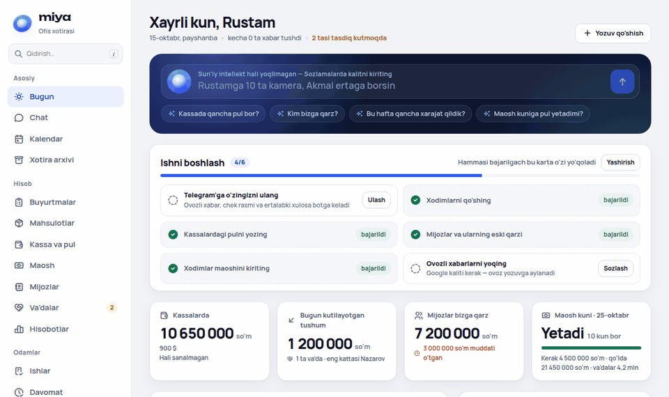
</div>

**Asosiy qoida:** pulni **dastur** hisoblaydi, sun'iy intellekt faqat gapni tushunib yozuv **taklif qiladi**. Har bir yozuv kartochka bo'lib qaytadi («To'g'ri / Tuzatish»), har fakt o'z manbasiga (asl xabarga) bog'langan, hech narsa o'chirilmaydi — faqat tuzatiladi yoki bekor qilinadi. Kalit berilmasa ham dastur tugmalar bilan to'liq ishlaydi.

## Asosiy imkoniyatlar

| | |
|---|---|
| 💬 **Chat birinchi** | Telegram bot va web chat — bitta miya: bir xil tushunish, bir xil kartochkalar. Pul, ish, va'da bo'lmagan gap ham **xotira** bo'lib saqlanadi (uchrashuv, eslatma, kelishuv) |
| 💰 **Ikki yoqlama hisob** | Har pul harakati «qayerdan → qayerga» yoziladi; xodimlar orasida beruvchi va oluvchi tasdig'i («berdim / oldim»). Xodim yozgan pul boshliq tasdig'idan o'tadi |
| 🧾 **Maosh** | Oylik, kunbay, ishbay va foiz — jonli hisob, avans va qarzni ushlash, oy yopish, maosh kuni ogohlantirishi |
| 🛠️ **Ishlar va davomat** | Ish berish, dalil (rasm) bilan yopish, kechikish belgisi, takroriy ishlar; bitta «Keldim / Ketdim» joylashuv tugmasi |
| 🤝 **Mijozlar va va'dalar** | Mijoz kartasi va tarixi, nasiya muddati o'zi va'daga aylanadi, va'da bajarilmasa mas'ul va boshliqqa eslatma; «uzoq kelmagan» mijozlar |
| 📦 **Buyurtmalar (CRM)** | Mahsulot katalogi, bosqichlar (yangi → taklif → sotildi → bajarildi), «sotildi» bo'lganda sotuv, qarz va o'rnatish ishi avtomatik |
| 📅 **Kalendar va eslatma** | Uchrashuv, eslatma, ish muddati, va'da va maosh kuni bitta joyda; vaqtni dastur hisoblaydi («20 daqiqadan keyin», «juma kuni») |
| 📊 **Hisobotlar** | Foyda-zarar, xarajat turlari, sotuv mijoz va sotuvchi kesimida, kassa aylanmasi, qarz yoshi — Excel'ga (formula in'ektsiyasidan himoyalangan) |
| 🔎 **Qidiruv va arxiv** | O'zbekcha ildiz bo'yicha qidiruv (lotin va kirill), asl xabar topiladi — ovozda o'sha soniyadan |
| ☀️ **Ertalabki xulosa** | Ish kunlari 08:30 da faktlarni dastur yig'adi; matndagi har raqam dastur hisobi bilan tekshiriladi, mos kelmasa — tayyor qolip |
| 🔐 **Xavfsizlik** | Kalit va tokenlar bazada **Fernet** bilan shifrlangan, jurnalga sirlar tushmaydi; ochiq internetda birinchi sozlash bir martalik kod bilan |

## Ekranlar

<table>
<tr>
<td width="50%">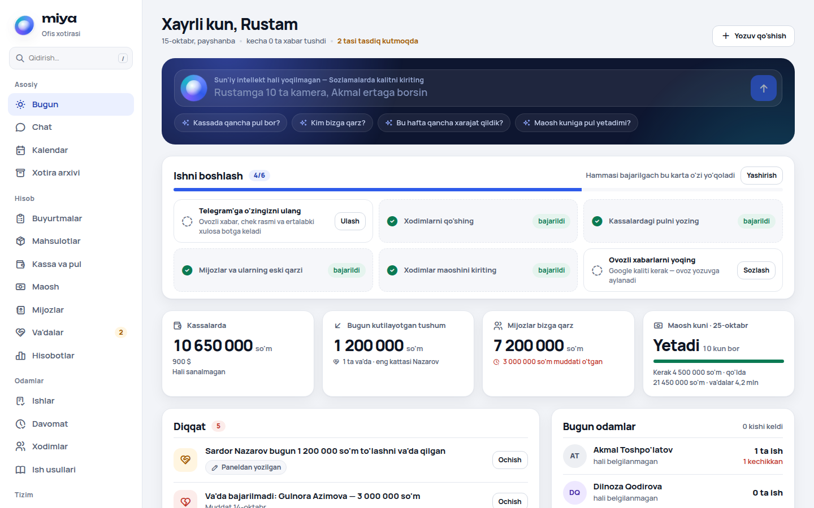<br/><sub><b>Bugun</b> — miya qatori, «Ishni boshlash», kassa, kutilayotgan tushum, diqqat</sub></td>
<td width="50%">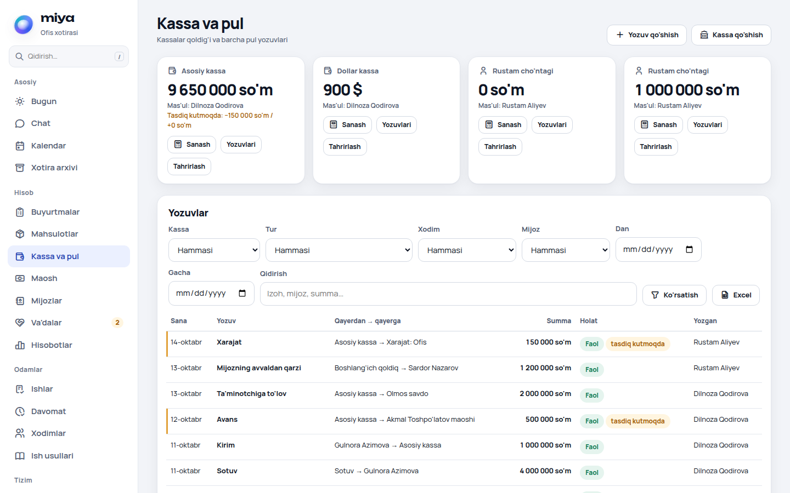<br/><sub><b>Kassa va pul</b> — kassalar qoldig'i, filtrlar, tasdiq kutayotgan yozuvlar</sub></td>
</tr>
<tr>
<td>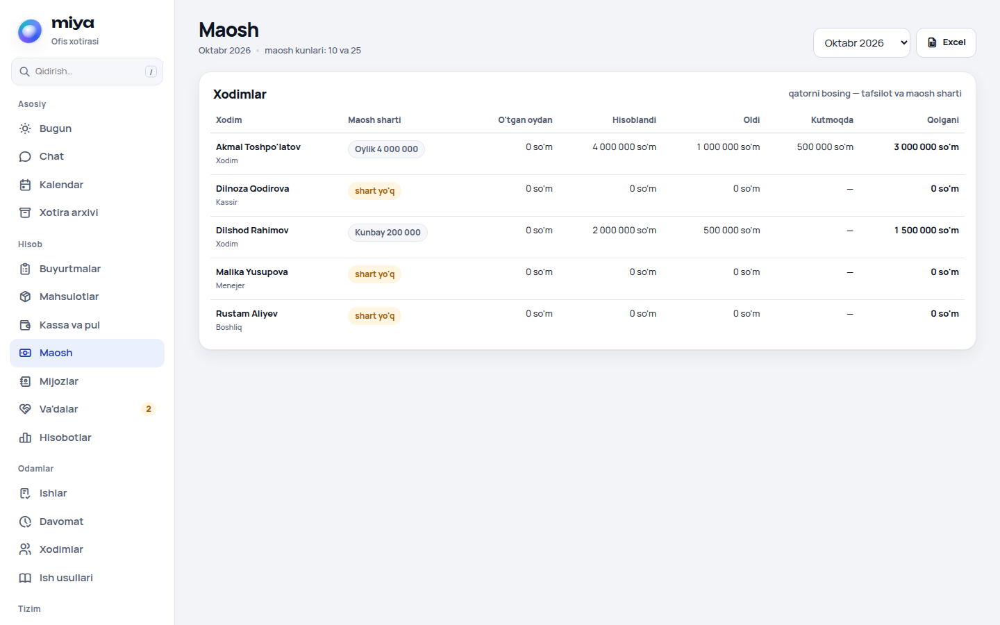<br/><sub><b>Maosh</b> — shart, hisoblangan, olgan, qolgani</sub></td>
<td>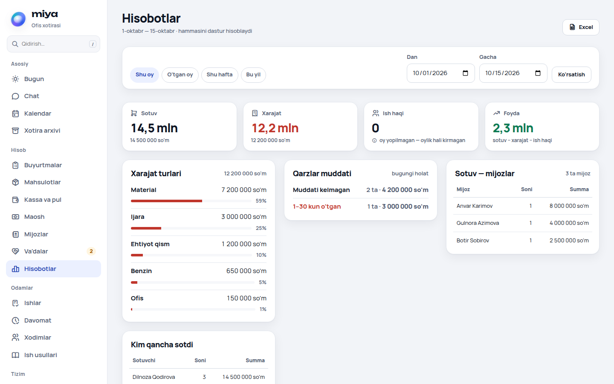<br/><sub><b>Hisobotlar</b> — sotuv, xarajat, foyda, qarz yoshi</sub></td>
</tr>
<tr>
<td>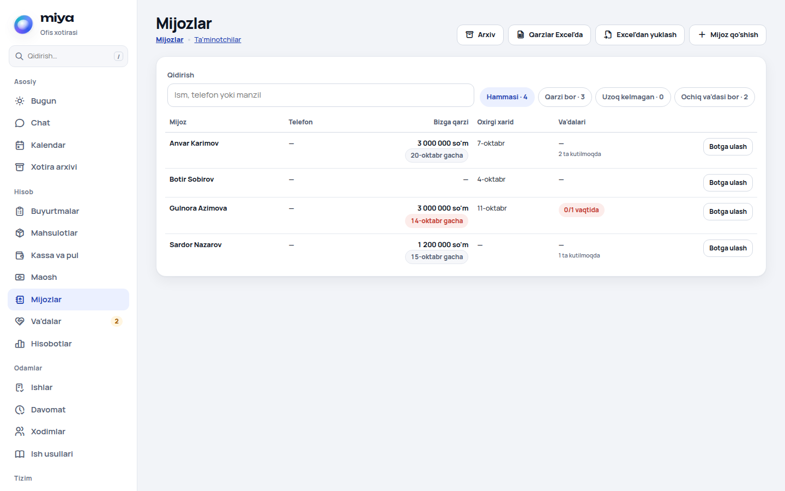<br/><sub><b>Mijozlar</b> — qarz, oxirgi xarid, va'dalar, Excel'dan yuklash</sub></td>
<td>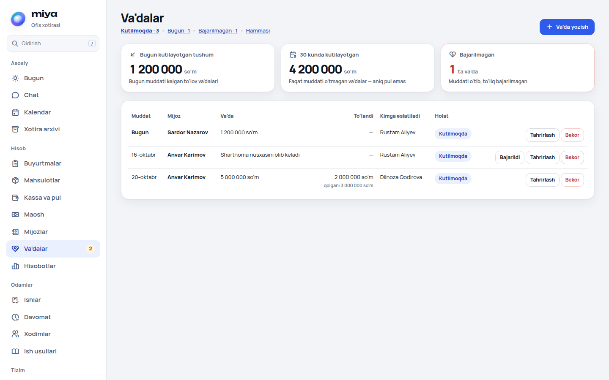<br/><sub><b>Va'dalar</b> — bugun kutilayotgan va bajarilmagan to'lov va'dalari</sub></td>
</tr>
<tr>
<td>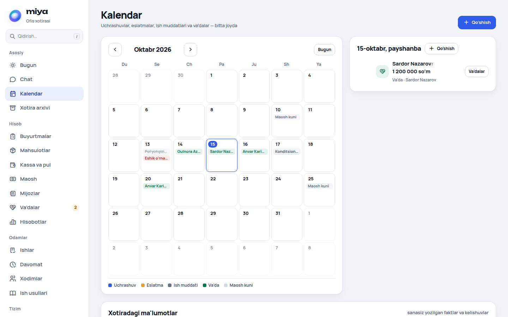<br/><sub><b>Kalendar</b> — uchrashuv, ish muddati, va'da, maosh kuni</sub></td>
<td>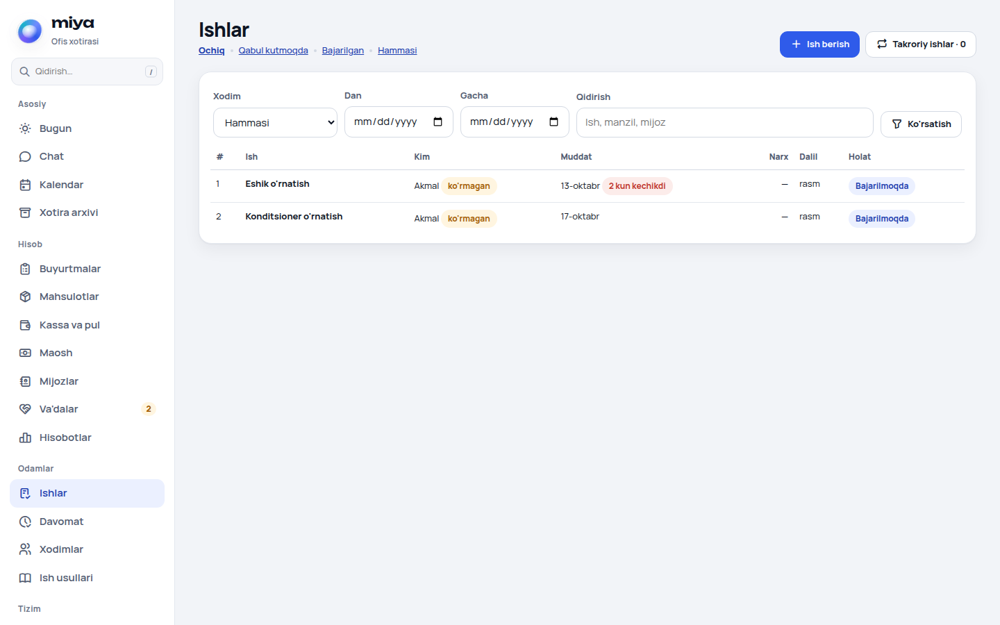<br/><sub><b>Ishlar</b> — ijrochi, muddat, kechikish, dalil</sub></td>
</tr>
<tr>
<td>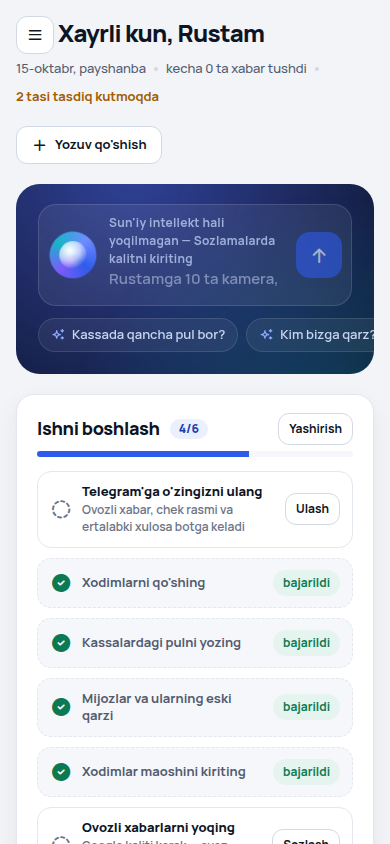<br/><sub><b>Telefon</b> — panelning mobil ko'rinishi</sub></td>
<td>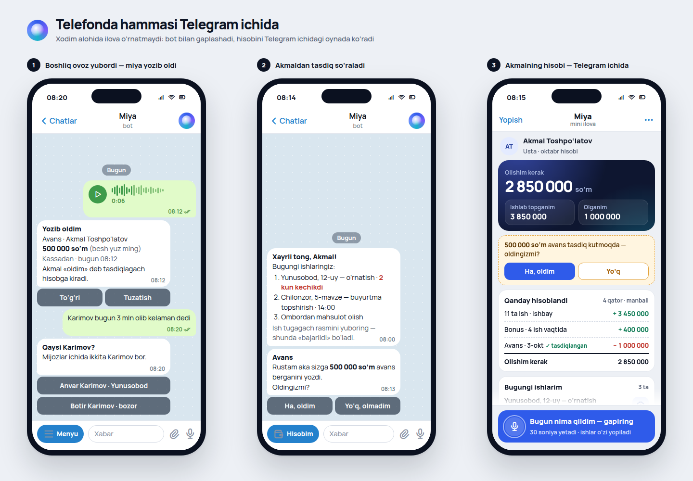<br/><sub><b>Dizayn maketi</b> — Telegram'da ovozli xabar → kartochka → xodim tasdig'i → «Mening hisobim»</sub></td>
</tr>
</table>

> Panel suratlari `sinov/nazorat.py` dagi **namuna ishxona** (5 odam, 3 kassa, 4 mijoz, oktabrning 1–14 kunlari) bilan olingan; ismlar va summalar o'ylab topilgan. Oxirgi rasm — dastlabki dizayn maketi.

## Arxitektura

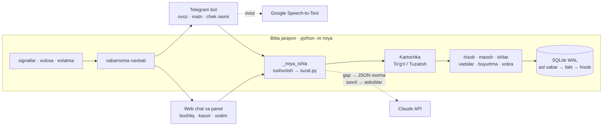

- **To'rt qavat xotira:** asl xabar → fakt (manbasi bilan) → dastur hisobi → boshliq qoidalari. Model raqamni hisoblamaydi: savolga javob asboblar (kassa, qarzlar, maosh, ishlar, xabarlar…) natijasidan yig'iladi va javobdagi raqamlar tekshiriladi.
- **Model xatolarini dastur tuzatadi** (`miya/tuzat.py`): pul yo'nalishi (mijoz ↔ ta'minotchi) bazadan, hafta kuni sanasi, nisbiy vaqt, takroriy yozuvlar.
- **Joylash:** Docker (`read_only`, `cap_drop: ALL`, port ochilmaydi) umumiy Caddy ortida; kunlik zaxira (baza + kalit, 14 kun); yangilashda sog'lik tekshiruvi o'tmasa eski versiya qaytadi.

## Sifat

- `python3 -m pytest sinov` — **182 ta sinov o'tadi** (~7 s). Telegram va sun'iy intellekt soxta (fake) qilib almashtiriladi — internetga chiqmaydi va pul sarflamaydi.
- **50 ta nazorat savoli** (`sinov/nazorat.py`): namuna ishxona va qo'lda hisoblangan aniq javoblar. Asbob rejimi har sinovda tekshiriladi: kerakli asbob natijasida to'g'ri raqam bor. Sinovning o'zi ham sinalgan — kutilgan javob ataylab buzilsa yiqiladi.
- To'liq rejim (`python3 sinov/nazorat.py --toliq`) va panel nazorati (`sinov/panel_nazorat.py`) haqiqiy model bilan ishlaydi va API kalitini talab qiladi.

## Ishga tushirish

```bash
pip install -r requirements.txt            # ovoz uchun tizimda ffmpeg ham kerak
python3 -m pytest sinov                    # 182 sinov

./ishga_tushir.sh                          # panel: http://127.0.0.1:8090
# birinchi kirishda boshliq hisobi yaratiladi; kalitlar (Claude API, Google, Telegram bot) — Sozlamalar sahifasida
```

Muhit o'zgaruvchilari — `.env.example`. Serverga joylash (Docker + Caddy):

```bash
MIYA_SERVER=root@SERVER_IP ornatish/joylash.sh miya.example.uz miyaapi.example.uz
```

## Texnologiyalar

Python 3.14 · FastAPI · Uvicorn · httpx · SQLite (WAL) · `cryptography` (Fernet) · openpyxl · Telegram Bot API va Mini App · Claude API — sun'iy intellekt provayderi (structured output + tool use) · Google Speech-to-Text · ffmpeg · kutubxonasiz JavaScript · Docker · Caddy · systemd taymerlari

## Jonli

🌐 **https://miya.geonazorat.uz** (kirish login bilan)

---

<div align="center">

**Manba kodi ochiq.** Savol va hamkorlik bo'yicha: Telegram [@Humoyun_Davronov](https://t.me/Humoyun_Davronov)

<sub>Muallif — Humoyun Davronov</sub>

</div>
